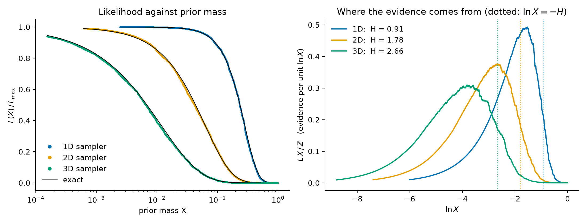
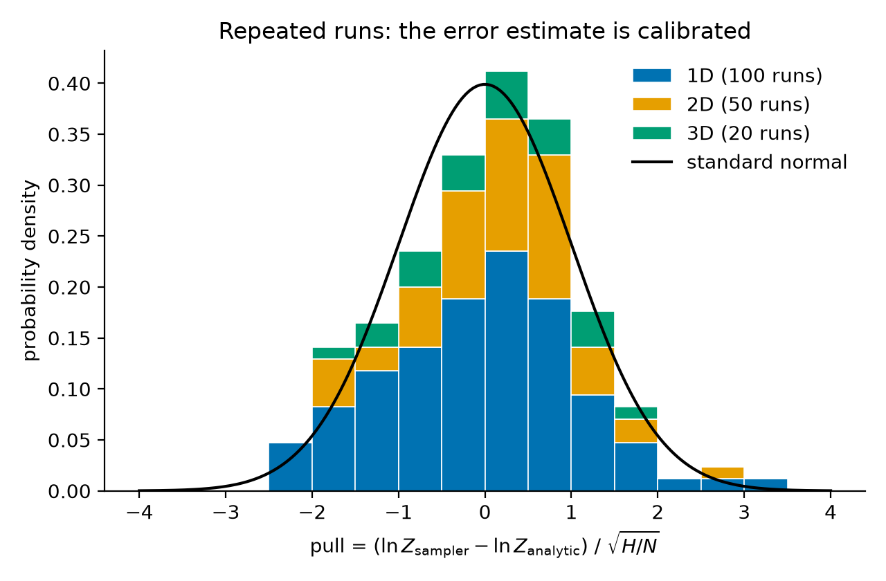
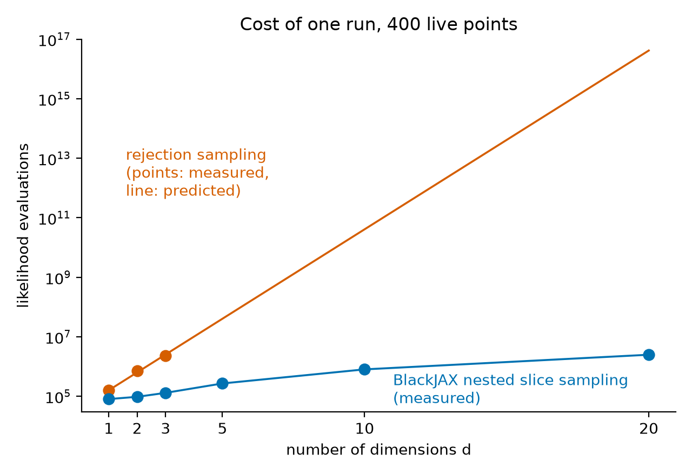
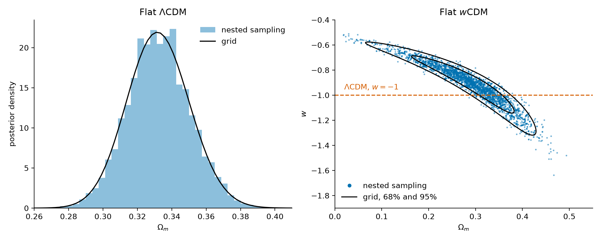

# Bayesian model comparison with nested sampling: ΛCDM vs. wCDM with Pantheon+ supernovae

I built this project to understand nested sampling properly, from the basic algorithm up to a real cosmological model comparison. It has three stages, and each one builds on the one before.

1. **A nested sampler in NumPy.** I tested it on Gaussian problems where the evidence is known exactly.
2. **The same tests with BlackJAX Nested Slice Sampling**, the GPU-oriented method from Will Handley's group. I wanted to see for myself why slice sampling replaces the rejection step, and how much that buys in higher dimensions.
3. **A real model comparison.** I computed the Bayesian evidence for flat ΛCDM against flat wCDM using the Pantheon+ supernovae.

| Stage | Question | Result |
|---|---|---|
| 1 | Does my sampler recover the analytic $`\ln Z`$? | Yes, in 1, 2 and 3 dimensions. Over 170 repeated runs it shows no bias, and its error bar is the right size. |
| 2 | Does BlackJAX agree, and does it scale? | Yes. It agrees with the analytic value from 1 to 20 dimensions. In 20D, rejection sampling would need about $`10^{16}`$ likelihood calls. |
| 3 | Do the Pantheon+ supernovae prefer wCDM over ΛCDM? | No. $`\ln B = -2.11 \pm 0.06`$ (wCDM minus ΛCDM), which favours ΛCDM. A direct integration on a grid gives $`-2.08`$. |

I produced every result here on a CPU. Stages 2 and 3 use GPU-capable code (JAX), but I have not run it on a GPU.

## Stage 1: A rejection-sampling nested sampler in NumPy

Files: `nested_sampler.py`, `gaussian_test.py`, `stage1_plots.py`, `stage1_calibration.py`

I started with a basic rejection-sampling nested sampler and went through it line by line against the maths below. Then I extended it in two ways: it now returns the likelihoods and prior masses of the dead points, and it has a second error estimate (`simulate_logz`). I also added the plots and the calibration test described in this section.

### The idea

The Bayesian evidence for a model is

```math
Z = \int \mathcal{L}(\theta)\,\pi(\theta)\,d\theta .
```

Define the prior mass enclosed by the likelihood contour $`\mathcal{L} = \lambda`$:

```math
X(\lambda) = \int_{\mathcal{L}(\theta) > \lambda} \pi(\theta)\,d\theta .
```

$`X`$ falls from 1 to 0 as $`\lambda`$ rises, so the multi-dimensional integral becomes a one-dimensional one:

```math
Z = \int_0^1 \mathcal{L}(X)\,dX .
```

### The algorithm

1. Draw $`N`$ live points from the prior.
2. Find the live point with the lowest likelihood, $`\mathcal{L}_i`$.
3. Shrink the prior mass: $`X_i = t_i X_{i-1}`$, where $`t_i`$ is the largest of $`N`$ uniform numbers, so $`t_i \sim \mathrm{Beta}(N, 1)`$ and $`\langle \ln t_i \rangle = -1/N`$. This gives $`X_i \approx e^{-i/N}`$.
4. Add its contribution, $`Z \mathrel{+}= \mathcal{L}_i\,w_i`$ with $`w_i = X_{i-1} - X_i`$.
5. Replace that point with a new prior draw that has $`\mathcal{L} > \mathcal{L}_i`$.
6. Stop when the live points can add at most `dlogz` to $`\ln Z`$, then add the remaining live points, each with weight $`X_{\rm final}/N`$.

The posterior weight of each point is $`p_i = \mathcal{L}_i w_i / Z`$. The information is

```math
H = \sum_i p_i \ln\frac{\mathcal{L}_i}{Z},
```

and the statistical uncertainty on the log-evidence is $`\sigma(\ln Z) \approx \sqrt{H/N}`$.

Everything is computed in log space to avoid underflow.

### The test

Likelihood: a normalised $`d`$-dimensional Gaussian with mean $`\mu`$ and width $`\sigma`$. Prior: uniform on $`[-a, a]^d`$. Then

```math
Z = (2a)^{-d}\prod_{k=1}^{d}\left[\Phi\!\left(\frac{a-\mu_k}{\sigma}\right) - \Phi\!\left(\frac{-a-\mu_k}{\sigma}\right)\right],
```

which is very close to $`(2a)^{-d}`$ when the Gaussian sits well inside the box.

Results with $`a = 5`$, $`\sigma = 1`$, $`\mu = 0`$ and $`N = 400`$ live points, produced by `gaussian_test.py`:

| $`d`$ | $`\ln Z`$ (sampler) | $`\ln Z`$ (analytic) | Difference | Likelihood calls |
|---|---|---|---|---|
| 1 | −2.318 ± 0.048 | −2.303 | −0.3σ | 159,651 |
| 2 | −4.619 ± 0.067 | −4.605 | −0.2σ | 710,518 |
| 3 | −6.930 ± 0.082 | −6.908 | −0.3σ | 2,334,175 |

### The likelihood as a function of prior mass

The figure below is produced by `stage1_plots.py`.



Left: the curve $`\mathcal{L}(X)`$ that the sampler traced out, against the exact curve. For this problem the contour is a sphere of radius $`r`$, so $`X = V_d r^d/(2a)^d`$ and $`\mathcal{L}(X) = \mathcal{L}_{\max}\exp[-r(X)^2/2\sigma^2]`$. The small offsets between the points and the line are real, not plotting errors. The sampler assumes $`X_i = e^{-i/N}`$, but the true $`X_i`$ wanders around that value. This is where the error on $`\ln Z`$ comes from.

Right: since $`dX = X\,d\ln X`$, the quantity $`\mathcal{L}X`$ is the evidence contributed per unit $`\ln X`$. Its peak is where the posterior sits. $`H`$ sets how far the sampler has to compress to get there, which is why the run length grows with $`N H`$. This plot provided a clearer understanding of the role of $`H`$.

### Is the error bar right?

A single run that lands 0.3σ from the true value says little about whether the error bar is correct. To test this, I repeated the run with many independent random seeds (`stage1_calibration.py`) and compared the scatter between runs with the estimated error.



| $`d`$ | Runs | Mean difference from analytic | Scatter between runs | Mean estimated error $`\sqrt{H/N}`$ |
|---|---|---|---|---|
| 1 | 100 | −0.003 ± 0.005 | 0.053 | 0.047 |
| 2 | 50 | +0.009 ± 0.009 | 0.061 | 0.066 |
| 3 | 20 | +0.008 ± 0.018 | 0.080 | 0.081 |

The mean difference is consistent with zero, and the scatter matches the estimated error to within the precision that this many runs allows.

`simulate_logz` in `nested_sampler.py` gives a second error estimate. Instead of using the mean shrinkage, it draws every $`t_i`$ from $`\mathrm{Beta}(n_i, 1)`$ many times and looks at the spread of the resulting $`\ln Z`$. In 2D it gives 0.067, the same as $`\sqrt{H/N}`$.

### Limitation

New points are found by rejection sampling from the whole prior. A prior draw lands inside the contour with probability $`X`$, so each new point costs about $`1/X`$ likelihood calls, and a whole run costs about $`N/X_{\rm final}`$. That is 2.3 million calls in 3D, and for this problem it grows by a factor of 4 with each extra dimension. This limitation motivates Stage 2.

## Stage 2: BlackJAX Nested Slice Sampling

Files: `blackjax_runner.py`, `stage2_blackjax_gaussian.py`

`blackjax_runner.py` is my run loop around `blackjax.nss`. I based it on the Handley group's BlackJAX nested sampling workshop. It keeps the outer loop, the stopping rule and the bookkeeping in one place, so Stages 2 and 3 can share them.

### Why slice sampling replaces rejection

The outer loop is unchanged: remove the worst live points, add $`\mathcal{L}_i w_i`$, replace them. Only the replacement step is different.

- **Rejection** draws from the whole prior and accepts a point only if it lands inside the contour. The cost per point is $`1/X`$, which grows exponentially as the run goes on.
- **Slice sampling** starts from a live point that is already inside the contour and moves it. It picks a random direction, finds the stretch of that line that lies inside the contour, and jumps to a uniformly chosen point on it. After a few such moves, the new point is effectively independent of its starting point. The cost per point is roughly the same at any $`X`$.

Nested Slice Sampling also removes and replaces many points per step. The replacements are independent of each other, so they can be computed in parallel. That is what makes the method suited to GPUs.

### Results

I used the same Gaussian problem, with $`N = 400`$ live points, 20 points replaced per step and $`\max(5, 2d)`$ slice moves per new point. The results below are produced by `stage2_blackjax_gaussian.py`:

| $`d`$ | $`\ln Z`$ (analytic) | $`\ln Z`$ (BlackJAX) | Difference | BlackJAX calls | Rejection calls |
|---|---|---|---|---|---|
| 1 | −2.303 | −2.301 ± 0.047 | +0.0σ | 80,639 | 159,651 |
| 2 | −4.605 | −4.755 ± 0.073 | −2.1σ | 95,982 | 710,518 |
| 3 | −6.908 | −6.988 ± 0.085 | −0.9σ | 130,488 | 2,334,175 |
| 5 | −11.513 | −11.546 ± 0.111 | −0.3σ | 270,039 | ~4 × 10⁷ (predicted) |
| 10 | −23.026 | −23.369 ± 0.154 | −2.2σ | 802,409 | ~4 × 10¹⁰ (predicted) |
| 20 | −46.052 | −46.048 ± 0.213 | +0.0σ | 2,491,452 | ~4 × 10¹⁶ (predicted) |

I measured the rejection calls for $`d \le 3`$ with the Stage 1 sampler. For $`d \ge 5`$ I predicted them from $`N/X_{\rm stop}`$ and did not run them.



Two of these six single runs are about 2σ low. I did not want to dismiss that result without further investigation, so the script repeats the run 20 times in 2D and in 10D to test whether the offset is a statistical fluctuation or a bias:

| $`d`$ | Runs | Mean difference from analytic | Scatter between runs | Mean estimated error |
|---|---|---|---|---|
| 2 | 20 | +0.017 ± 0.017 | 0.078 | 0.069 |
| 10 | 20 | −0.013 ± 0.028 | 0.124 | 0.152 |

The mean difference is consistent with zero in both cases, so there is no sign of a bias at this precision. The two 2σ runs were statistical fluctuations.

The BlackJAX error on $`\ln Z`$ is estimated by simulating the shrinkage factors, the same idea as `simulate_logz` in Stage 1.

## Stage 3: ΛCDM against wCDM with Pantheon+

Files: `cosmology.py`, `stage3_pantheon.py`, `stage3_plots.py`, `data/download_pantheon.py`

Having validated both samplers on problems with known answers, I applied them to a real model-comparison problem.

### The data and the likelihood

Pantheon+ gives a standardised apparent magnitude $`m_i`$ for each Type Ia supernova. If every supernova has the same absolute magnitude $`M`$,

```math
m_i = \mu(z_i) + M, \qquad \mu = 5\log_{10}\frac{d_L}{10\ \mathrm{pc}}, \qquad d_L = (1+z_{\rm hel})\,\frac{c}{H_0}\int_0^{z_{\rm HD}}\frac{dz'}{E(z')} .
```

For a flat universe with matter and dark energy of constant equation of state $`w`$,

```math
E(z)^2 = \Omega_m(1+z)^3 + (1-\Omega_m)(1+z)^{3(1+w)} ,
```

and ΛCDM is the case $`w = -1`$. The errors are correlated, so the likelihood uses the published statistical + systematic covariance matrix $`C`$:

```math
\ln\mathcal{L} = -\tfrac12\, r^{T}C^{-1}r - \tfrac12\ln\det(2\pi C), \qquad r_i = m_i - \mu(z_i) - M .
```

The choices I made:

- I removed supernovae with $`z_{\rm HD} \le 0.01`$, as in the Pantheon+ cosmology analysis. This leaves 1590 of the 1701 light curves.
- $`H_0`$ and $`M`$ cannot be separated with supernovae alone, since both shift every magnitude by a constant. I fixed $`H_0`$ at 70 km/s/Mpc and left $`M`$ free.
- I assumed a flat universe and ignored radiation.

### Priors

All uniform: $`\Omega_m \in [0.01, 0.99]`$, $`M \in [-20, -19]`$, and for wCDM $`w \in [-3, 1]`$.

### Results

The evidence calculations are in `stage3_pantheon.py`, and the figures are made by `stage3_plots.py`. Nested sampling uses 1000 live points and replaces 50 points per step with $`3d`$ slice moves each. I repeated it with 4 seeds for each model. The table gives the mean of the 4 runs. Its error is the typical single-run error (about 0.09) divided by $`\sqrt{4}`$. The scatter between the 4 runs is 0.10 for ΛCDM and 0.05 for wCDM, consistent with that single-run error.

| | $`\ln Z`$ (nested sampling) | $`\ln Z`$ (grid) |
|---|---|---|
| Flat ΛCDM | 838.05 ± 0.04 | 838.07 |
| Flat wCDM | 835.94 ± 0.05 | 835.99 |
| $`\ln B = \ln Z_{w{\rm CDM}} - \ln Z_{\Lambda{\rm CDM}}`$ | **−2.11 ± 0.06** | −2.08 |

A negative $`\ln B`$ favours ΛCDM. The value corresponds to odds of about 8 to 1 for ΛCDM, if the two models are equally likely beforehand.

The "grid" column is an independent check that uses no sampling at all. The likelihood is Gaussian in $`M`$, so I integrated $`M`$ out analytically. That leaves a one-dimensional integral over $`\Omega_m`$ for ΛCDM and a two-dimensional integral over $`(\Omega_m, w)`$ for wCDM. I did these with Simpson's rule on a 401 × 601 grid. Halving the grid resolution changes $`\ln Z`$ by less than $`10^{-8}`$.

As a further check, anesthetic (the Handley group's post-processing package) computes $`\ln Z`$ from the same dead points and agrees with my value to within 0.003.



Parameter constraints (posterior mean ± standard deviation):

| | Nested sampling (mean of 4 runs) | Grid | Brout et al. 2022, supernovae only |
|---|---|---|---|
| ΛCDM: $`\Omega_m`$ | 0.332 ± 0.018 | 0.332 ± 0.018 | 0.334 ± 0.018 |
| wCDM: $`w`$ | −0.91 ± 0.15 | −0.91 ± 0.15 | −0.90 ± 0.14 |
| wCDM: $`\Omega_m`$ | 0.286 ± 0.072 | 0.285 ± 0.072 | — |

The published values are only there for comparison. Brout et al. use their own priors and summary statistics, so exact agreement is not expected.

### Why ΛCDM wins

wCDM fits slightly better. Its best fit ($`\Omega_m = 0.29`$, $`w = -0.89`$) improves the maximum log-likelihood by only 0.23 (Δχ² = 0.45). But it spreads its prior over $`w \in [-3, 1]`$, and the data allow only a small part of that range. The evidence averages the likelihood over the prior, so the unused prior volume is a penalty (the Occam factor), and here it outweighs the small gain in fit.

Because of this, $`\ln B`$ depends on the prior I chose for $`w`$. Restricting the grid integral to narrower ranges gives:

| Prior on $`w`$ | $`\ln B`$ (grid) |
|---|---|
| $`[-3, 1]`$ | −2.08 |
| $`[-2, 0]`$ | −1.39 |
| $`[-1.5, -0.5]`$ | −0.69 |

ΛCDM is favoured in each case, but less strongly as the prior narrows. This was arguably the most insightful finding of the project: a Bayes factor answers a question about the models *and* their priors, and it should be reported with that in mind.

### How this relates to published work

Ong, Yallup & Handley (arXiv:2511.10631) report $`\ln B = -2.77 \pm 0.12`$ for w0waCDM against ΛCDM from DESI DR2 BAO + Pantheon+, which also favours ΛCDM. Their value cannot be compared directly with mine: their model has two dark-energy parameters ($`w_0`$, $`w_a`$), and their data include BAO. The comparison is only qualitative. Both analyses find that the evidence favours ΛCDM.

## How I checked it

I wanted every key result to be confirmed by an independent method. Every main component has its own check, and most of them are in the test suite (`pytest`, 18 tests):

- **Evidence on known problems.** Both samplers recover the analytic $`\ln Z`$ for Gaussians. The repeated runs show no bias, and the scatter matches the quoted error (Stages 1 and 2).
- **Distances.** The JAX distance modulus agrees with direct numerical integration (`scipy.integrate.quad`) across the prior range, and with the exact Einstein–de Sitter result.
- **Data selection.** The redshift cut keeps exactly 1590 supernovae.
- **Likelihood.** The JAX log-likelihood agrees with a plain NumPy version.
- **Integrating out $`M`$.** The analytic marginalisation agrees with a brute-force integral over $`M`$.
- **Evidence for the cosmology runs.** Nested sampling agrees with the grid integration, and anesthetic agrees with my $`\ln Z`$ from the same dead points.

I set the environment up again from `requirements.txt` on my own Windows laptop (Python 3.13) and reran all three stages. Every number matched the saved results, and all 18 tests passed.

## What this project does not do

- I have not run it on a GPU.
- Stage 3 uses supernovae alone, a flat universe and a constant $`w`$. It does not include BAO or CMB data, curvature, or evolving dark energy ($`w_0 w_a`$). Those are the obvious next steps.
- The Stage 1 sampler is a learning tool. It is only practical in a few dimensions.

## Usage

```bash
pip install -r requirements.txt

# Stage 1
python gaussian_test.py
python stage1_plots.py
python stage1_calibration.py          # a few minutes

# Stage 2
python stage2_blackjax_gaussian.py    # a few minutes

# Stage 3
python data/download_pantheon.py      # 34 MB, once
python stage3_pantheon.py             # about 30 minutes on a 2-core CPU
python stage3_plots.py

pytest
```

The numbers in this README were produced with Python 3.13, NumPy 2.5, SciPy 1.18, JAX 0.12 and BlackJAX 1.7.2.dev22 (main branch, pinned to a commit in `requirements.txt`), on a 2-core Linux CPU. The saved outputs are in `results/`. The Pantheon+ data files are not in the repository; `data/download_pantheon.py` fetches them from the official release.

## References

- J. Skilling, *Nested sampling for general Bayesian computation*, Bayesian Analysis 1, 833 (2006).
- D. Yallup, N. Kroupa, W. Handley, *Nested Slice Sampling: Vectorized Nested Sampling for GPU-Accelerated Inference*, arXiv:2601.23252.
- BlackJAX nested sampling workshop, github.com/handley-lab/workshop-blackjax-nested-sampling. The run loop in `blackjax_runner.py` follows it.
- D. Scolnic et al., *The Pantheon+ Analysis: The Full Data Set and Light-curve Release*, ApJ 938, 113 (2022).
- D. Brout et al., *The Pantheon+ Analysis: Cosmological Constraints*, ApJ 938, 110 (2022), arXiv:2202.04077.
- D. D. Y. Ong, D. Yallup, W. Handley, *A Bayesian Perspective on Evidence for Evolving Dark Energy*, arXiv:2511.10631.
